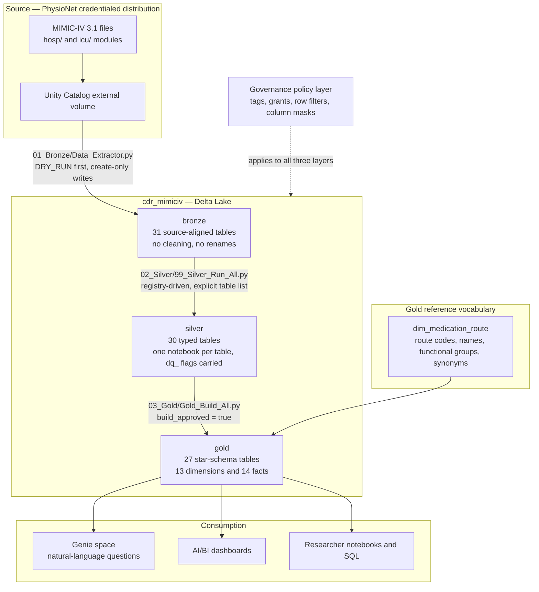
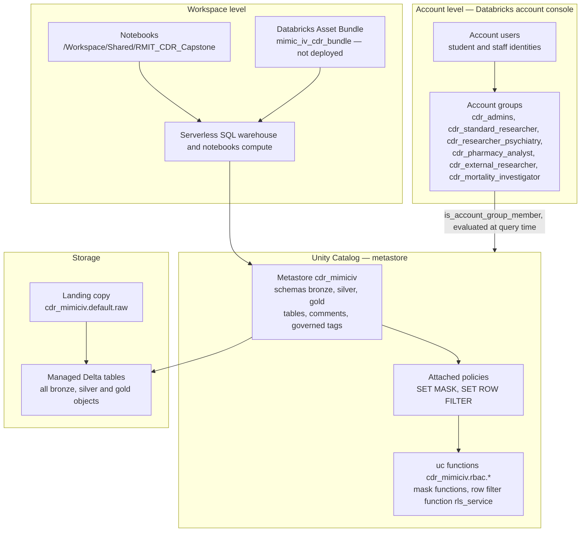
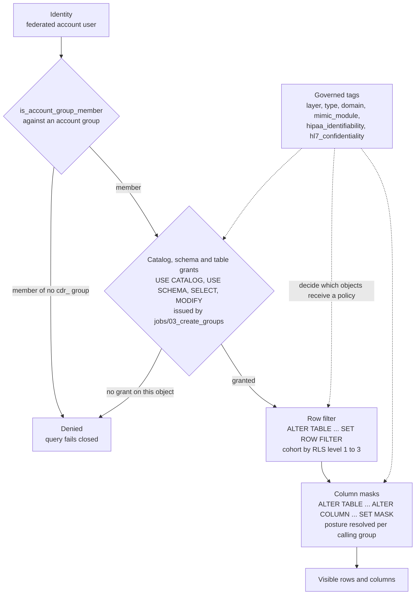
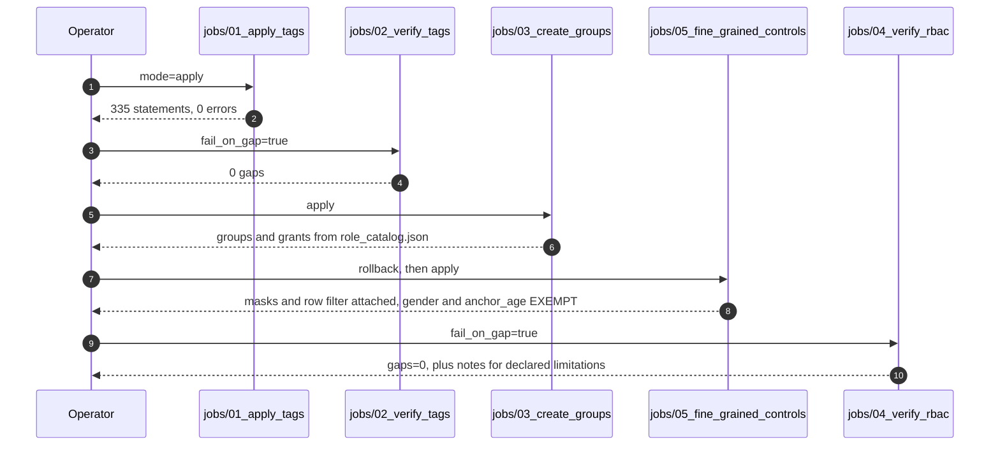

# Architecture blueprint

System diagrams and security boundaries for the RMIT Clinical Data Repository. Written 2026-10-26.

Audience: RMIT IT and Research, and the assessment panel. Everything here is drawn from the files in
this repository and the live catalog, not from a design that was intended but never built. Where the
implemented state differs from the intended one, [§6](#6-what-is-enforced-today-versus-declared) says so.

Mermaid renders in the Databricks workspace, in GitHub, and in most Markdown viewers. The source is
plain text, so the diagrams stay reviewable in a diff.

**Contents**

1. [Data flow](#1-data-flow)
2. [Medallion layers and their gates](#2-medallion-layers-and-their-gates)
3. [Platform and infrastructure topology](#3-platform-and-infrastructure-topology)
4. [Unity Catalog security boundaries](#4-unity-catalog-security-boundaries)
5. [The control chain](#5-the-control-chain)
6. [What is enforced today versus declared](#6-what-is-enforced-today-versus-declared)
7. [Privacy boundary: mapping the controls to the Australian Privacy Principles](#7-privacy-boundary-mapping-the-controls-to-the-australian-privacy-principles)
8. [Known limits](#8-known-limits)

---

## 1. Data flow

MIMIC-IV lands once, is shaped twice, and is consumed under a policy layer that surrounds all three
layers rather than sitting at the end of the pipeline.

Read the dotted edge as the point of the design: governance is not a stage after Gold. Tags are set
across Bronze, Silver and Gold, grants are issued per schema, and the masks and row filters attach
to Gold columns. Everything downstream of Gold is already subject to it.

## 2. Medallion layers and their gates

Each layer refuses to publish without an explicit approval. The gates are the reason a rebuild cannot
happen by accident.

```mermaid
flowchart LR
    subgraph BR["Bronze — source of record"]
        BR1["DRY_RUN = True by default"]
        BR2["create-only writes"]
        BR3["REBUILD needs REBUILD_CONFIRM"]
    end

    subgraph SI["Silver — typed and flagged"]
        SI1["tables=all is preview only"]
        SI2["real run needs an explicit table list"]
        SI3["approved_to_publish in 00_Silver_Registry"]
    end

    subgraph GO["Gold — analytics ready"]
        GO1["explicit table list"]
        GO2["approved_to_publish AND<br/>silver_sources_confirmed"]
        GO3["confirm_large_scan for scan=large"]
        GO4["CANDIDATE_VALIDATION_APPROVED<br/>on the registry path"]
    end

    BR --> SI --> GO
    GO --> OUT["Governed Gold tables"]
```

Approvals are reviewed changes: `approved_to_publish=True` is set together with `approved_by` and
`approved_on` in the registry, in a commit of its own. There is deliberately no override parameter
that bypasses a gate.

## 3. Platform and infrastructure topology

Two facts in that diagram are load-bearing. The first is that groups are **account** groups, not
workspace-local ones — the policies call `is_account_group_member()`, which fails closed for a
workspace-local group of the same name. The second is that the bundle is drawn deliberately as
*not deployed*: orchestration in this system is a notebook someone runs with an explicit mode.

## 4. Unity Catalog security boundaries

This is the boundary a query crosses. Each step can only narrow access, never widen it.

The tags are not decoration and they are not the enforcement. They are the input that decides *where*
Bob the enforcement lands: the tag walk in `jobs/01` classifies every table and column, `jobs/05`
reads that classification and attaches a mask or row filter accordingly, and `jobs/04` re-reads the
live `information_schema` policy views to confirm what was attached. A column that was never tagged
is a column with no policy — which is why the verification notebook treats a missing tag as a gap.

Boundary summary, outermost first:

| Boundary | What crosses it | Enforced by |
|---|---|---|
| Account to workspace | Federated identity, group membership | Databricks account, not this repository |
| Workspace to catalog | `USE CATALOG` | `jobs/03_create_groups` |
| Catalog to schema | `USE SCHEMA` per layer | `jobs/03_create_groups` |
| Schema to table | `SELECT` / `MODIFY`, domain-scoped for some roles | `jobs/03_create_groups`, driven by the `domain` tag |
| Table to rows | Row filter, RLS levels 1–3 | `jobs/05_fine_grained_controls` |
| Table to columns | Column masks by posture | `jobs/05_fine_grained_controls`, for every schema in `masking.masked_schemas` (gold and silver) |

## 5. The control chain

The order matters. Tags come first because domain-scoped grants are discovered from the `domain` tag;
masking comes after grants because a mask is only meaningful on a column someone can otherwise read.

Both verification steps can make the whole run red rather than print an advisory summary. That is the
difference between evidence and a log line. The remaining chaining work — folding `03`, `04` and `05`
into `jobs/governance_job.json` so one job run produces the entire trail — is tracked in
[`../HANDOVER.md`](../HANDOVER.md).

## 6. What is enforced today versus declared

An architecture diagram that shows everything working invites the wrong question. This is the honest
split as of 2026-10-26.

| Capability | State | Consequence |
|---|---|---|
| Classification tags on all three layers | **Enforced.** 335 statements, 0 errors, verified with 0 gaps | Complete PHI inventory |
| Account-group grants | **Enforced.** Six groups, one per demonstrated control: schema, column, row, table, and a classification-driven column posture | Least privilege on schemas and on domain-scoped tables |
| Column masks on Gold identifiers | **Enforced.** Live on the Gold identifiers; `gender` and `anchor_age` exempt by decision | Gold returns masked direct identifiers |
| Column masks on Silver identifiers | **Implemented in the chain, not yet applied.** `jobs/01` tags the Silver identifier columns and `jobs/05` masks every schema in `masking.masked_schemas`. The separate `apply_masks_notebook` that used to own this could not run and is now in `_archive/` | Silver still returns raw identifiers to anyone holding `USE SCHEMA` + `SELECT` — a locked front door with an open back door until the chain is run with `05` in `apply` mode |
| Row filters | **Enforced across every Gold fact.** Three functions: `rls_service` on `dim_service(service)`, `rls_hadm_service_filter_int` / `_bigint` on the 11 facts carrying `hadm_id`, `rls_subject_service_filter_int` on `dim_patient(subject_id)` | `fact_service` is excluded because the admission filter reads it, and a filter on the table it reads recurses. The remaining Gold tables are dimensions with neither key, reported as a note by `jobs/04` |
| Mask exemptions | **Enforced by decision.** `dim_patient.gender` and `anchor_age` are unmasked | Deliberate — these are analysis dimensions, not identifiers |
| Auditing | **Native, not captured.** The model relies on Databricks system tables rather than custom notebooks | No audit evidence artefact exists in this repository yet; see [§8](#8-known-limits) |
| Automated ingestion | **Not automated.** A notebook run with an explicit mode | The bundle that would schedule it is undecided and undeployed |

## 7. Privacy boundary: mapping the controls to the Australian Privacy Principles

MIMIC-IV is de-identified and the CDR is a research repository, so the privacy obligations that bind
the *custodian* of the identified data do not all transfer to this platform. The controls here are
nonetheless the mechanism by which RMIT can demonstrate the APPs it does carry. The table maps what
the platform actually does to the principle it serves.

This is an engineering mapping, not a legal opinion. RMIT's privacy office owns the formal position,
and the entries marked **open** are questions to put to them rather than claims being made here.

| APP | What it requires | Control in this platform | Where |
|---|---|---|---|
| **APP 1** — open and transparent management | Know what personal information you hold and manage it consistently | Every table and column carries classification tags plus the MIMIC-IV official comments, so the inventory is machine-readable and verifiable rather than a document that drifts | `jobs/01_apply_tags`, `02_Catalog_Metadata_and_Tags.py`, `comments.json` |
| **APP 2** — anonymity and pseudonymity | Where practicable, let people deal with you without identifying themselves | MIMIC-IV is de-identified at source: `subject_id` is a per-patient surrogate, not a name, MRN or Medicare number | source distribution, Bronze provenance note |
| **APP 3, APP 5** — collection and notification | Collect only what is needed; notify the individual at collection | **Not engaged at this boundary.** Collection happened upstream under the PhysioNet credentialed-access agreement and RMIT ethics approval. The CDR inherits the dataset; it does not collect from individuals | credentialing, not code |
| **APP 4, APP 7** — unsolicited information, direct marketing | Handle unsolicited personal information; restrict direct marketing | **Not engaged.** Fixed dataset, no marketing function | — |
| **APP 6** — use and disclosure | Use and disclose personal information only for the purpose it was collected | Role-scoped `SELECT` on purpose: a pharmacy analyst reaches the pharmacy and demographics domains, an external researcher reaches diagnostics only, and cohort roles are separated | `rbac/role_catalog.json`, `jobs/03_create_groups` |
| **APP 8** — cross-border disclosure | Know where the information goes and account for it | **Open.** This is decided by the workspace and metastore region, which the repository does not record. Confirm the region and document it before claiming APP 8 alignment | operational, not in code |
| **APP 9** — government related identifiers | Do not adopt a government identifier as your own | **Not applicable, and verified as such.** No Medicare, MRN, DVS or other government identifier is ingested. `subject_id` is a surrogate, and `fact_order.poe_id` derives from it | asserted in benchmark Q12 |
| **APP 10** — quality of personal information | Take reasonable steps to keep personal information accurate | Silver flags quality rather than silently correcting it: `dq_*` booleans travel with the values, and the rule inventory is consolidated read-only for review | `02_Silver/`, `05_Data_Quality_Governance.py` |
| **APP 11.1** — security | Take reasonable steps to protect personal information | Tags drive grants, row filters and column masks, enforced by Unity Catalog at query time rather than by convention or by careful SQL | `jobs/01` → `05`, verified by `jobs/02` and `jobs/04` |
| **APP 11.2** — destroy or de-identify when no longer needed | Retain no longer than necessary | Delta time travel retains history by design, so retention is an explicit decision rather than a default. `Utils/CleanUp.py` is the only destructive path and is deliberately manual | `Utils/CleanUp.py` |
| **APP 12, APP 13** — access and correction | Let individuals access and correct their information | **Not engaged through this platform.** MIMIC-IV is de-identified, so there is no individual to notify and no identified record to correct here; correction flows through the source custodian | credentialing, not code |

Two consequences worth stating plainly for the report:

- **The strongest APP story this platform tells is APP 1, APP 6 and APP 11.1**, because in each case
  the control is machine-enforced and independently verified rather than asserted in prose.
- **The weakest is APP 11.1 for Silver**, until `jobs/05` is run in `apply` mode. The
  same principle that is well served on Gold is only partly served one layer down. That gap is the
  first item in [`../HANDOVER.md`](../HANDOVER.md) §3 for exactly this reason.

## 8. Known limits

Recorded here so a reader does not have to discover them:

1. **Silver masking is implemented but not yet applied.** `jobs/01` tags the Silver identifier columns
   and `jobs/05` masks every schema in `masking.masked_schemas`, but until the chain is run with `05`
   in `apply` mode, a user holding `USE SCHEMA` and `SELECT` on Silver reads raw identifiers. The
   separate `apply_masks_notebook` that used to own this could not run at all — it wanted a
   classification table that does not exist — and is archived.
2. **A schema grant can outrun the catalog.** `cdr_cmo_admin`, `cdr_data_engineers`,
   `cdr_researcher_peds`, `cdr_hospital_researchers` and `cdr_bi_developer` are no longer provisioned
   by `role_catalog.json`, yet they still hold live grants on **silver and bronze** as well as gold.
   `03_create_groups` never revokes, so deleting a role from the catalog does not remove its access;
   the masks cover these groups, so no raw identifier leaks, but the grants are drift. This is the
   concrete reason Silver masking matters at all, and it is the kind of drift a review should catch by
   diffing grants against the catalog rather than by trusting the catalog.
3. **Death dates are treated differently by layer.** Silver `patients.dod` carries no tag, so no mask,
   while Gold's `deathtime` is `hl7_confidentiality = V_Very_Restricted`. Left as found: deciding it is
   a policy call, not a defect.
4. **Row-level security covers one table.** 27 of 28 Gold tables carry no cohort column, so RLS
   levels 1 and 2 cannot filter them. The governance verification notebook reports this as a note
   rather than a gap, because it is a property of the data model, not a defect in the controls.
5. **No captured audit evidence.** The design relies on Databricks-native auditing and lineage
   instead of a bespoke audit platform, which is the right call. It does mean that demonstrating
   *audited* access — as the project brief asks for — needs evidence collected from the platform:
   a query against `system.access.audit` filtered to `cdr_mimiciv`, captured alongside the mask and
   filter evidence in `HANDOVER.md` §6.
6. **`poe_id` may derive from `subject_id`.** Order IDs are built from the patient identifier plus a
   sequence, so a mask on `dim_patient.subject_id` alone does not hide the patient from
   `fact_order.poe_id`. Benchmark Q12 tests exactly this and should be re-checked after any masking
   change.
7. **The bundle is not deployed.** Orchestration is manual. The `mimic_iv_cdr_bundle/` directory
   records intended orchestration and has never been applied.
